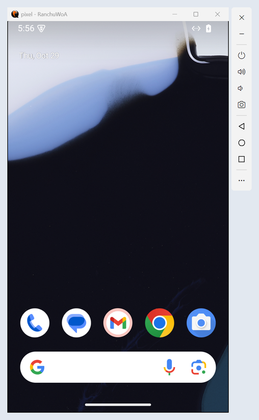
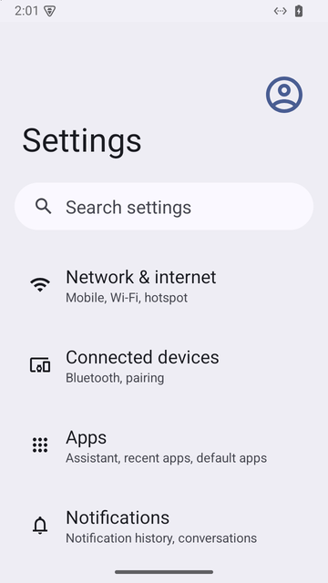
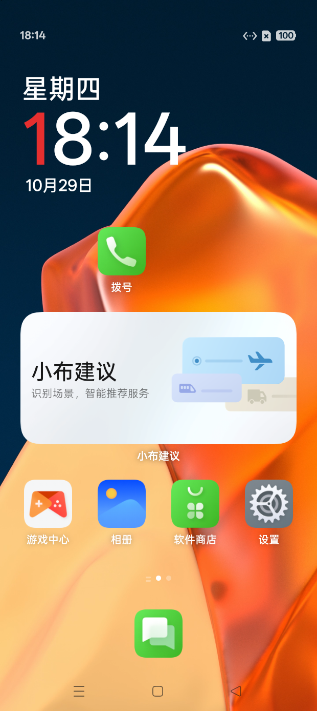
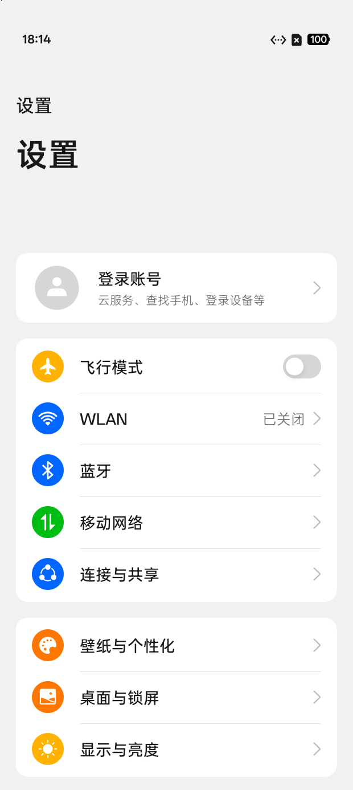
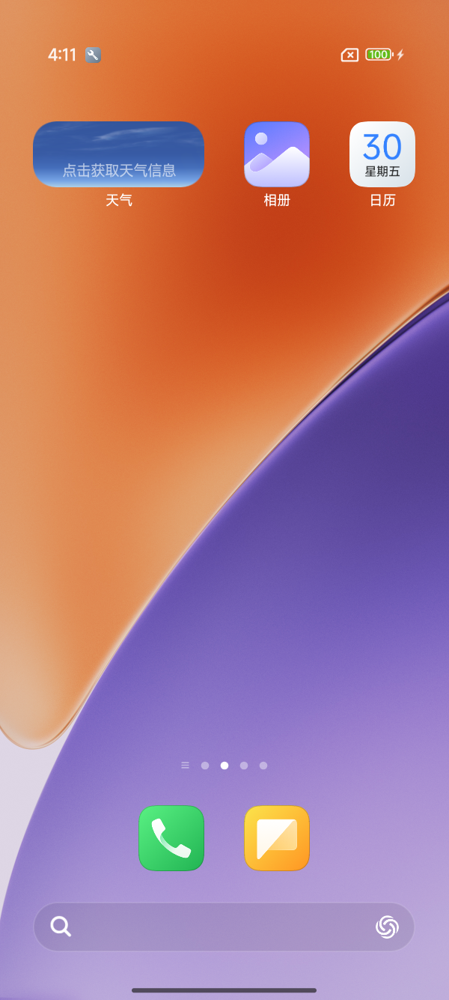
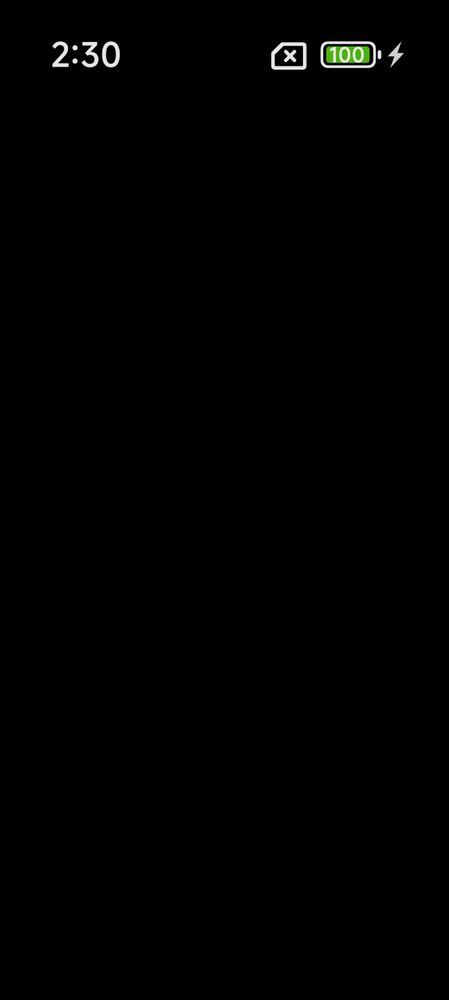
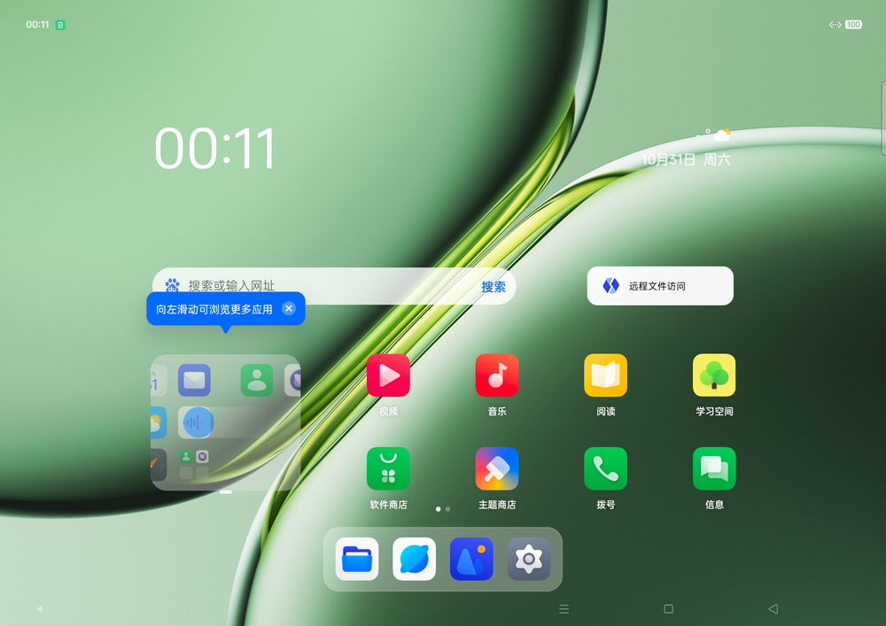
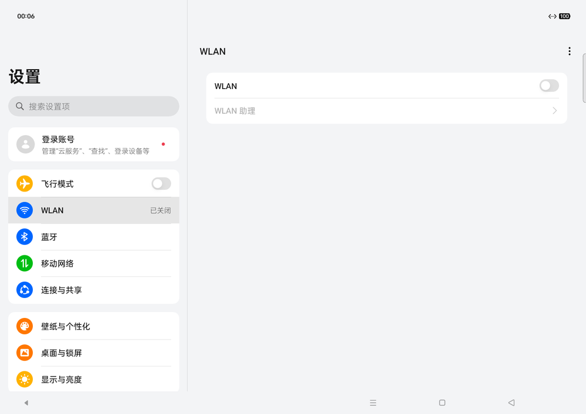

# RanchuWoA — Windows on ARM 原生 Android 模拟器

在 Windows on ARM（骁龙 X Elite 等）上用 **QEMU + WHPX 硬件虚拟化** 原生运行 Google 官方 Android 15 系统镜像
（android-35 google_apis arm64-v8a），用法类似 Android Studio 的 AVD。不依赖 WSL；图形可以走宿主 GPU（gfxstream →
ANGLE → Direct3D 11），也可以完全在 guest 里用 CPU 渲染（SwiftShader）。

<p>


</p>

> 这个项目因何而存在？只是好玩啦，如果你的预算充足，其实可以使用 [HyperOS-AVD](https://github.com/NEORUAA/HyperOS-AVD) / [ColorOS-AVD](https://github.com/YuKongA/ColorOS-AVD) !

## 运行环境

- Windows 11 ARM64（在 Snapdragon X Elite X1E78100、Windows 11 build 26220 上验证）
- 已启用「Windows 虚拟机监控程序平台」：管理员 PowerShell 运行
  `Enable-WindowsOptionalFeature -Online -FeatureName HypervisorPlatform`，然后重启
- Python 3.10+（`py` 启动器）
- 可选：Android platform-tools（adb）；Pillow（截屏脚本 `scripts/hmp.py --shot` 用）
- 磁盘：官方镜像 zip 1.8 GB + 基础镜像 3.7 GB + 每个实例 1–3 GB 起（userdata 按需增长，上限默认 8 GB）

QEMU 优先使用自带 DLL 的 `dist/qemu`；没有时用开发构建 `qemu-ranchu/build`（需要 MSYS2，见「从源码构建」）。

## 快速开始

在项目根目录（cmd / PowerShell；Git Bash 里用 `py tools/avdctl/avdctl.py` 代替 `avdctl`）：

```bat
avdctl prepare          :: 一次性：下载官方镜像（1.8 GB）和 Alpine 工具，生成基础镜像（下载完后约 20 秒）
avdctl create pixel     :: 创建实例，并在后台无窗口跑完首次开机（约 1 分钟）
avdctl start pixel      :: 打开窗口和右侧工具栏（--wait 等开机完成，--headless 不开窗口）
adb devices             :: emulator-5554
avdctl stop pixel       :: 正常关机
```

## avdctl 命令

| 命令 | 说明 |
|---|---|
| `prepare [--force]` | 生成/重建基础镜像 `images/base/android-35`。`--force` 重建后会自动重建所有实例的系统盘（userdata 保留） |
| `create <名字> [选项]` | 选项：`--width 720 --height 1280 --density 320 --ram 4096 --cores 4 --data-size 8G`、`--gpu gfxstream\|swiftshader`（见「图形后端」）、`--audio dsound\|sdl\|none`、`--mic`、`--no-firstboot`、`--system <盘>`（自定义系统盘，见「运行 GSI」） |
| `list` | 列出实例、adb 序列号、运行状态 |
| `edit <名字> [选项]` | 修改已有实例（需先 stop）：`--width --height --density --ram --cores --gpu --audio --mic/--no-mic`，下次启动生效；`--system <盘>` 换/重新挂上自定义系统盘（只重建写时复制层，userdata 保留） |
| `start <名字> [--wait] [--headless] [--foreground] [--no-toolbar]` | 启动（同时打开侧边工具栏）；`--foreground` 在当前终端前台运行 QEMU；排查用：`--verbose-boot`（内核/init 日志全部进 `logs/console.log`）、`--selinux permissive\|enforcing`（只影响这次） |
| `toolbar <名字>` | 给运行中的实例重新打开侧边工具栏（已开着时不会重复打开） |
| `stop <名字> [--force]` | 正常关机（与关窗口相同：QMP `system_powerdown` → 经 adbd `svc power shutdown`），不行再试串口控制台和 adb，超时后强制退出；`--force` 直接退出 |
| `wipe <名字> [--no-firstboot]` | 恢复出厂（重建 userdata） |
| `delete <名字>` | 删除实例 |
| `geo <名字> <纬度> <经度> [海拔]` | 设置 GPS 位置；运行中立即生效，并记入实例配置 |
| `dist` | 把 QEMU 和 qemu-img 连同所需 DLL（含 gfxstream、rutabaga 与 ANGLE，共约 70 个）打包到 `dist/qemu`，之后不再需要 MSYS2 |

### 实例文件与端口

`images/avds/<名字>/`：

- `config.json` 配置；`run.json` 运行中的 pid 和端口
- `system.qcow2` 系统盘（基础镜像上的写时复制层）、`data.qcow2` userdata、`encryptionkey.img` metadata 分区
- `logs/qemu.log` QEMU 输出（开机完成时有 `ranchu: guest boot completed`）、`logs/logcat.txt` 持续写入的 logcat、
  `logs/console.log` 串口控制台的全部输出、`logs/toolbar.log` 工具栏的错误输出、
  `logs/firstboot.log`、`logs/userdata.log`

第 i 个实例（`config.json` 的 index）的端口：adb `5555+2i`（序列号 emulator-`5554+2i`），
串口控制台 `25400+10i`，HMP 监视器 `25401+10i`，QMP `25402+10i`，工具栏专用 QMP `25403+10i`，都只监听 127.0.0.1。

- adb server 晚于模拟器启动时，最多 30 秒后自动发现；也可以直接 `adb connect 127.0.0.1:5555`。
  出现 `offline` 时运行 `adb reconnect offline`。
- 串口控制台是 guest 的 shell（`su 0` 提权）：`py scripts/vserial.py` 或任意 TCP 客户端。
  QEMU 的 Windows TCP 串口不适合反复重连，尽量保持一条连接。
- 截屏：工具栏的相机按钮（存到「图片\屏幕截图」），或 `py scripts/hmp.py --port 25401 --shot out.png`。
  输入自动化：`scripts/qmp_input.py`（tap/swipe/key/text）。

## 图形后端

| `--gpu` | 渲染 | 说明 |
|---|---|---|
| `gfxstream` | 宿主 GPU：guest 的 GLES 调用编码后经 virtio-gpu 转给 QEMU 里的 gfxstream，再由 ANGLE 转成 Direct3D 11 | 单帧耗时约为 SwiftShader 的一半以下、不占 guest CPU；OpenGL ES 3.0 |
| `swiftshader` | guest 内 CPU 渲染（SwiftShader） | 不依赖宿主图形驱动，兼容性兜底；OpenGL ES 3.0 |

`avdctl edit <名字> --gpu swiftshader|gfxstream` 随时切换（下次启动生效，两种后端都已装在基础镜像里）。
两种模式都没有 Vulkan。gfxstream 模式下宿主出问题时，`logs/qemu.log` 里会有 `RanchuWoA-VEH` 开头的崩溃记录。

## 运行 GSI（实验性）

可以把基础镜像里的 system 分区换成别的 Android 15 GSI（Generic System Image），沿用我们的 vendor（图形、输入、vsock 服务）；
Android 14 的 GSI 要额外适配（见下面 ColorOS 14 的例子与 [GSI 适配指南](docs/gsi-guide.md) §2.6）：

```sh
# 1. 生成实验盘：基础盘 + GSI（原始或 sparse 的 system.img），并给 vendor 打 GSI 兼容补丁
py scripts/gsi_disk.py images/base/android-35/system.img <GSI 的 system.img> images/gsi/my-gsi.img
# 2. 用它建实例（GSI 一般比较吃资源；分辨率按 GSI 的源机型配，见下面 ColorOS/HyperOS 的例子）
py tools/avdctl/avdctl.py create mygsi --system images/gsi/my-gsi.img --ram 6144 --cores 6 --no-firstboot
py tools/avdctl/avdctl.py start mygsi --wait          # 起不来时加 --verbose-boot 看 logs/console.log
```

厂商系统的界面是按源机型的屏幕调的（比例、dp 尺寸，有的参数直接按像素写死），默认的 720x1280（16:9）会让桌面、
状态栏错位。先查源机型的分辨率和 `ro.sf.lcd_density`（`adb shell getprop ro.sf.lcd_density`），再按宿主屏幕高度选一个
等比缩小的分辨率（密度同比例缩小，dp 尺寸不变），用 `avdctl edit <名字> --width W --height H --density D` 修改。

<p>




</p>

- **AOSP Android 15 GSI**（developer.android.com 的 `aosp_arm64` user 版）：直接开机到锁屏。user 版 adb 需要在屏幕上授权。
- **ColorOS 15 GSI**（社区移植的 Mystic GSI）：再跑一次 `py scripts/coloros_gsi_fixes.py images/gsi/my-gsi.img`
  （OPLUS 框架按真机 CPU 簇拓扑工作，不打补丁 system_server 每分钟崩一次），之后开机到桌面、可以触摸操作，约 50–125 秒。
  这个移植包来自一加 Ace 2V（PHP110，1240x2772，DPI 560），建实例时加 `--width 620 --height 1386 --density 280`
  （原机的一半：界面布局与真机相同，在 1600 像素高的屏幕上 1:1 显示，比原机分辨率流畅约 2.5 倍）；
  要逐像素还原就用 `--width 1240 --height 2772 --density 560`（软件渲染会明显变卡）。
- **HyperOS 2.0 GSI**（社区移植的 Mystic GSI，移植自小米 15）：再跑一次
  `py scripts/hyperos_fixes.py images/gsi/my-gsi.img`（三处补丁：实验盘 vendor 恢复蓝牙特性声明——小米的
  MiuiNetworkMonitor 在 system_server 里假定 BluetoothAdapter 非空，去掉特性会每 17 秒崩一次；vold 的
  f2fs 空闲维护假定 /data 在 device-mapper 上，对裸 virtio 盘会空指针 → `reboot(vold-failed)` 无限重启；
  以及注释掉 build.prop 里小米 15 的 `ro.sf.lcd_density=520`、`ro.opengles.version`（GLES 3.2）等属性，
  否则它们抢在 vendor 之前生效，密度和 GLES 版本都不对；可重复运行），之后约 2 分钟开机到桌面，
  壁纸、状态栏、通知栏/控制中心、触摸、联网（天气小组件有实时数据）、设置都正常。建实例加
  `--width 600 --height 1335 --density 260`（小米 15 的 1200x2670@520 的一半，同为 369x822 dp、20:9）。
  MIUI 应用会按屏幕物理尺寸再算一遍自己的密度（AutoDensity），avdctl 会让虚拟屏按实例密度报物理尺寸，
  应用实际约 246 dpi，与真机比例一致（都是约 392 dp 宽，改 `--density` 也不会变）；想再大一点用 HyperOS
  设置里的字体/显示大小。
  GMS（Google Play 服务）会反复报域验证异常，无害。
  它超时灭屏很快（锁屏 10 秒、桌面 1 分钟）：工具栏电源键或 `adb shell input keyevent WAKEUP` 亮屏，
  工具栏「更多 → 显示与电源 → 保持唤醒」（即 `adb shell svc power stayon true`）保持常亮。
- **ColorOS 14 GSI**（社区移植的 Mystic GSI，Android 14，移植自一加 Pad Pro 平板）：Android 14 的系统跑在我们
  Android 15 的 vendor 上要逐项降级（SELinux 映射、VINTF 版本、linkerconfig、A15 符号、内核版本识别……），
  再加 OPLUS 框架只认高通/联发科、32 位 mediaserver 等问题，全部由脚本处理：在 `coloros_gsi_fixes.py` 之后再跑
  `py scripts/coloros14_fixes.py images/gsi/my-gsi.img`（依赖 `images/gsi/coloros15-system.img`，即 ColorOS 15
  GSI 的原始 system.img，从中取几个 A15 系统库；可重复运行）。这是平板固件，建实例用横屏
  `--width 1500 --height 1060 --density 210`（原机 3000x2120@420 的一半）。首次开机约 95 秒，之后 35–60 秒；
  锁屏、桌面、设置（平板双栏）、触摸、联网正常。蓝牙不可用，几个 OPLUS 应用会周期性崩溃重启，无害。

<p>


</p>

- GSI 都是 user 版，SELinux 总是 enforcing；GSI 引用了 vendor 策略里没有的类型时，用 `scripts/gsi_undef_types.py`
  找出来补到 `gfx/vendor-overlay/gsi/gsi_sepolicy.cil`。
- 没有开机向导的 GSI（如这个 ColorOS 移植包）不会写 `device_provisioned`/`user_setup_complete`，Android 会一直不响应
  主屏幕键和最近任务；QEMU 在每次开机完成后经 adbd 把它们补成 1（无需手动处理）。
- 实验盘是基础盘的拷贝：`avdctl prepare --force` 之后要用 `gsi_disk.py`（ColorOS 再加 `coloros_gsi_fixes.py`、
  ColorOS 14 再加 `coloros14_fixes.py`、HyperOS 再加 `hyperos_fixes.py`）重新生成，再 `avdctl edit <名字> --system <盘>` 重新挂上（只重建写时复制层，
  userdata 保留）。

## 工作原理

```
                 ┌ swiftshader：SwiftShader GLES（guest，CPU）── 经 AHardwareBuffer 锁 gralloc ─┐
App / hwui ─────┤                                                                              │
SurfaceFlinger ─┤                                                                              ├→ ranchu hwc3（client 合成，
bootanimation ──┤                                                                              │   AddFB2 + atomic commit）
                 └ gfxstream：GLES 编码器（guest）→ virtio-gpu → QEMU rutabaga → gfxstream ────┘   → virtio-gpu → SDL 窗口
                                                    → ANGLE → Direct3D 11（宿主 GPU）
                woa gralloc：AIDL IAllocator v2 + stable-C IMapper v5（gfxstream 模式下缓冲就是宿主 ColorBuffer）
```

- **机器**：WHPX 只支持 `virt` 板，ranchu 兼容层是 `virt` 上的开关 `-M virt,ranchu-devices=on`：注入 Android 固件
  节点和 goldfish 设备（pipe/sync/battery），并把 system/metadata/userdata 三块盘钉到 ranchu 约定的 virtio-mmio 槽位。
- **图形**：官方镜像的 gralloc、composer、EGL 原本连官方模拟器的宿主渲染器（goldfish 管道 + gfxstream），这里换成：
  自研 gralloc（`gfx/gralloc`）+ 原镜像的 hwc3（client 模式直接扫描输出到 virtio-gpu）+ 二选一的 GLES 实现——
  Android 平台版 SwiftShader（`gfx/swiftshader`），或自编译的 gfxstream guest 编码器（`gfx/gfxstream-guest`，走 virtio-gpu
  而不是 goldfish 管道）配宿主的 gfxstream + rutabaga + ANGLE。gfxstream 模式下 gralloc 的缓冲是 virtio-gpu 资源、即宿主
  ColorBuffer，CPU 读写由 mapper 经 virtio-gpu transfer 与宿主同步。改动写进 super 里的 vendor 分区
  （`scripts/vendor_install.py`，在 Alpine 辅助 VM 里用 e2fsprogs 完成）。
- **qemud 服务**：Android 15 的模拟器服务（传感器、开机属性、剪贴板、GPS、摄像头列表…）走 virtio-vsock，Windows 没有
  vhost-vsock，`ranchu-vsock-device` 在 QEMU 里实现了用户态 virtio-vsock 及这些服务，并把宿主端口转发给 guest 的 adbd；
  关窗口/`system_powerdown` 时它还会自己当 adb 客户端让 guest 执行 `svc power shutdown`（与电源菜单的"关机"同一流程），
  每次开机完成后同样执行 avdctl 给的开机命令（`boot-cmd`）。
- **首次开机**：`create`/`wipe` 在后台跑完首次开机，顺带把「私人 DNS」设为关闭（NAT 后面用不上 DNS-over-TLS，
  默认的"自动"模式在网络就绪前会让解析服务空转）。
- **输入**：`virtio-touchscreen-pci`（单点触摸屏，另带返回/主屏幕/最近任务三个按键）+ `virtio-keyboard-pci`；
  SDL UI 修了 Windows 上的死锁并支持高 DPI。
- **声音**：`virtio-sound-pci` + 官方镜像的 goldfish 音频 HAL（tinyalsa）。

深入文档：[系统架构与引导链](docs/architecture.md) · [自研 goldfish/virtio 设备](docs/goldfish-devices.md) ·
[图形栈](docs/graphics.md) · [GSI 适配指南](docs/gsi-guide.md) · [排查手册](docs/debugging.md)。

## 从源码构建

项目目录里已有构建产物（`gfx/gralloc/out`、`gfx/egl-out`、`gfx/device-libs`），只改 QEMU 时不必重建 guest 组件。
改了 `qemu-ranchu`、`gfx/swiftshader`、`gfxstream`、`mesa-aosp` 的源码后，用 `bash scripts/make_patches.sh` 重新生成 `patches/`。

### 依赖

- [MSYS2](https://www.msys2.org/) 装在 `C:\msys64`，CLANGARM64 环境，参考包：
  ```sh
  pacman -S --needed git patch diffutils \
    mingw-w64-clang-aarch64-{toolchain,cmake,ninja,python,pkgconf,glib2,pixman,SDL2,libslirp,dtc,capstone,zstd,qemu} \
    mingw-w64-clang-aarch64-{meson,rust,angleproject}
  ```
  `mingw-w64-clang-aarch64-qemu` 提供 qemu-img，也会带齐 QEMU 的运行时依赖；meson/rust/angleproject 用于 gfxstream 模式
  （ANGLE 是运行期依赖）。
- Android NDK r27c，解压到 `gfx/android-ndk-r27c`（x86_64 版，在 ARM64 Windows 上经仿真运行）。
- Python 包：`py -m pip install ext4 pillow`。
- gfxstream guest 构建还要 protoc 21.12（解压到 `downloads/protoc21`）。
- 只在修改 AIDL 时需要：Android SDK build-tools 34（`aidl.exe`）。

### QEMU（补丁版 11.1.2）

```sh
tar -xf downloads/qemu-11.1.2.tar.xz && mv qemu-11.1.2 qemu-ranchu   # https://download.qemu.org/qemu-11.1.2.tar.xz
cd qemu-ranchu && patch -p1 < ../patches/qemu-11.1.2-ranchuwoa.patch
mkdir build && cd build
PKG_CONFIG_PATH="$(cygpath -m "$PWD/../../hostgfx/lib/pkgconfig")" \
PATH="/c/msys64/clangarm64/bin:/c/msys64/usr/bin:$PATH" ../configure --target-list=aarch64-softmmu \
  --disable-docs --enable-sdl --disable-sdl-image --disable-gtk --disable-curses --disable-tools --enable-rutabaga-gfx
PATH="/c/msys64/clangarm64/bin:/c/msys64/usr/bin:$PATH" ninja qemu-system-aarch64.exe
```

`--enable-rutabaga-gfx` 需要先构建下面的 gfxstream 宿主部分（`hostgfx/`）。

然后 `avdctl dist` 打包（可选）。补丁点在源码里都有 `RanchuWoA` 注释。

### guest 图形组件

```sh
# 设备库（交叉编译时链接）：从基础镜像的 system/vendor 分区里取
py gfx/fetch_device_libs.py images/base/android-35/system.img

# SwiftShader：停在仍有 GLES 前端的旧提交，打本地补丁（关掉 autocrlf，补丁按 LF 生成）
git -c core.autocrlf=false clone https://github.com/google/swiftshader.git gfx/swiftshader
git -C gfx/swiftshader checkout 606261c75c2a686ee5a9331e2141d3ed946986f4
git -C gfx/swiftshader apply ../../patches/swiftshader-606261c7-ranchuwoa.patch
bash gfx/build_swiftshader.sh          # → gfx/egl-out

bash gfx/gralloc/build.sh              # → gfx/gralloc/out（AIDL 生成代码已在 gen/，改 AIDL 才需 gen_aidl.sh）
```

### gfxstream（宿主 + guest）

```sh
git clone https://github.com/google/gfxstream.git && git -C gfxstream checkout 0ab696d
git -C gfxstream apply ../patches/gfxstream-0ab696d-ranchuwoa.patch
git clone --filter=blob:none --sparse https://android.googlesource.com/platform/external/mesa3d mesa-aosp
git -C mesa-aosp sparse-checkout set include/drm-uapi src/gfxstream src/util && git -C mesa-aosp checkout 224e91e
git -C mesa-aosp apply ../patches/mesa-aosp-224e91e-ranchuwoa.patch
git clone https://github.com/magma-gpu/rutabaga_gfx.git && git -C rutabaga_gfx checkout 5bcb95f
git clone https://gitlab.freedesktop.org/mesa/drm.git libdrm && git -C libdrm checkout 33fab8c

bash gfx/build_gfxstream_host.sh       # → hostgfx/（libgfxstream_backend、rutabaga_gfx_ffi），之后再配置 QEMU
bash gfx/build_gfxstream_guest.sh      # → gfx/gs-out（guest 的 EGL/GLES 与 libOpenglSystemCommon）
```

基础镜像还没有时，`fetch_device_libs.py` 需要的 system.img 可以先跑一次 `avdctl prepare` 得到：它在装 vendor 组件前
发现产物缺失会停下，此时解出的 system.img 还是原版。改完 guest 组件或 `gfx/vendor-overlay` 后运行
`avdctl prepare --force` 重建基础镜像。

## 目录

| 路径 | 内容 |
|---|---|
| `tools/avdctl/avdctl.py`、`avdctl.cmd` | AVD 管理工具 |
| `tools/avdctl/toolbar.py` | 侧边工具栏（start 时自动打开） |
| `qemu-ranchu/` | 补丁版 QEMU 源码与构建目录（`hw/android/` 是新增设备） |
| `patches/` | QEMU、SwiftShader、gfxstream、mesa-aosp 的补丁（对原版源码） |
| `gfxstream/`、`mesa-aosp/`、`rutabaga_gfx/`、`libdrm/` | gfxstream 相关上游源码（宿主渲染器、guest 编码器、rutabaga FFI、DRM 头） |
| `hostgfx/` | 宿主 gfxstream 链路的安装前缀（`bin/` 下两个 DLL；可选 `angle/` 放自选的 ANGLE） |
| `gfx/gfxstream-guest/`、`gfx/gs-out/` | guest 侧 gfxstream 的 CMake 构建（含 Android 头文件垫片）与产物 |
| `gfx/gralloc/` | woa gralloc（allocator 服务 + IMapper v5） |
| `gfx/swiftshader/`、`gfx/ss-build/`、`gfx/egl-out/` | SwiftShader 源码、构建目录、剥符号后的产物 |
| `gfx/vendor-overlay/` | 装进 vendor 分区的配置（init rc、VINTF、fstab、特性开关、SELinux 补充；`gsi/` 是 GSI 实验专用） |
| `scripts/` | vendor 改造（`vendor_install.py`、`alpine_job.py`、`superimg.py`）、GSI 实验（`gsi_disk.py`、`coloros_gsi_fixes.py`、`coloros14_fixes.py`、`hyperos_fixes.py`、`gsi_undef_types.py`）、调试工具（`hmp.py`、`qmp_input.py`、`vserial.py`、`vpull.py`、`vxfer.py`、`ext4tool.py`，抓真实窗口查闪烁的 `flicker_cap.py`、`window_cap.py`）、开发启动脚本 `boot_woa.sh`、补丁生成 `make_patches.sh`；`legacy/` 是早期实验脚本 |
| `images/base/`、`images/avds/`、`images/gsi/` | 基础镜像、各实例、GSI 实验盘 |
| `images/android-35/arm64-v8a/` | 开发用镜像（`scripts/boot_woa.sh` 引导） |
| `docs/` | 主题文档（架构、设备、图形、GSI、排查）与 AOSP/内核参考源码摘录（`docs/reference/`） |
| `downloads/`、`dist/`、`logs/`、`debug/` | 下载缓存、打包的 QEMU、历史实验日志、内核符号等调试材料 |

## 故障排查

- **启动即退出，日志提示 WHPX 不可用**：确认已启用 HypervisorPlatform 并重启过。
- **端口被占用**：`avdctl list` 看哪个实例在运行；上次异常退出残留的 QEMU 可以在任务管理器结束。
- **窗口黑屏**：多半是灭屏了，点工具栏的电源键或按 Ctrl+Alt+P 亮屏。
- **工具栏没出来 / 被关掉了**：`avdctl toolbar <名字>` 重新打开；出错信息在实例的 `logs/toolbar.log`。
  工具栏需要 Python 自带的 Tk（官方安装包默认带）。
- **卡在开机动画/起不来**：看 `images/avds/<名字>/logs/logcat.txt`；logcat 起来之前就出问题时用
  `avdctl start <名字> --verbose-boot`，看 `logs/console.log` 里的内核与 init 日志。仍不行就 `wipe`。
- **gfxstream 模式异常（黑屏、花屏、QEMU 退出）**：先 `avdctl edit <名字> --gpu swiftshader` 确认是否与宿主渲染有关；
  `logs/qemu.log` 搜 `RanchuWoA-VEH`。想试别的 ANGLE（Electron/Chromium 自带的 ARM64 版 `libEGL.dll`+`libGLESv2.dll`）
  就放进 `hostgfx/angle/`，或用环境变量 `RANCHU_ANGLE` 指向所在目录。
- **adb 显示 offline**：`adb reconnect offline`，或 `adb kill-server` 后等半分钟。
- **Git Bash 里中文乱码**：用 `py -X utf8 ...`（avdctl 自己已处理）；adb 的 guest 路径被改写时 `export MSYS_NO_PATHCONV=1`。

## 许可

本项目以 [Apache License 2.0](LICENSE) 发布。部分内容来自第三方，保留其原有许可：

- `docs/reference/` 的源码摘录仅供对照阅读、不参与编译，以各文件自身的许可头为准（多数 Apache-2.0，两个 goldfish sync 驱动为 GPL-2.0），来源见 [docs/reference/README.md](docs/reference/README.md)。
- `gfx/gralloc/aidl/`、`gfx/gralloc/include/` 的 AIDL 与头文件来自 AOSP（Apache-2.0）。
- `gfx/legacy/nullgfx/platform-libs/libbinder_ndk.so` 取自官方 Android 15 模拟器镜像中的同名系统库（源码为 AOSP libbinder_ndk，Apache-2.0）。
- 运行所需的 QEMU、SwiftShader 与 Android 系统镜像由脚本从各自官方渠道下载，本项目不分发；`patches/` 下的补丁分别适用于其上游源码（QEMU 为 GPL-2.0，SwiftShader、gfxstream 为 Apache-2.0，Mesa 为 MIT）。
  `avdctl dist` 打出的目录会带上 MSYS2 的运行库与 ANGLE（BSD-3-Clause）、rutabaga_gfx（BSD-3-Clause）等第三方 DLL。
